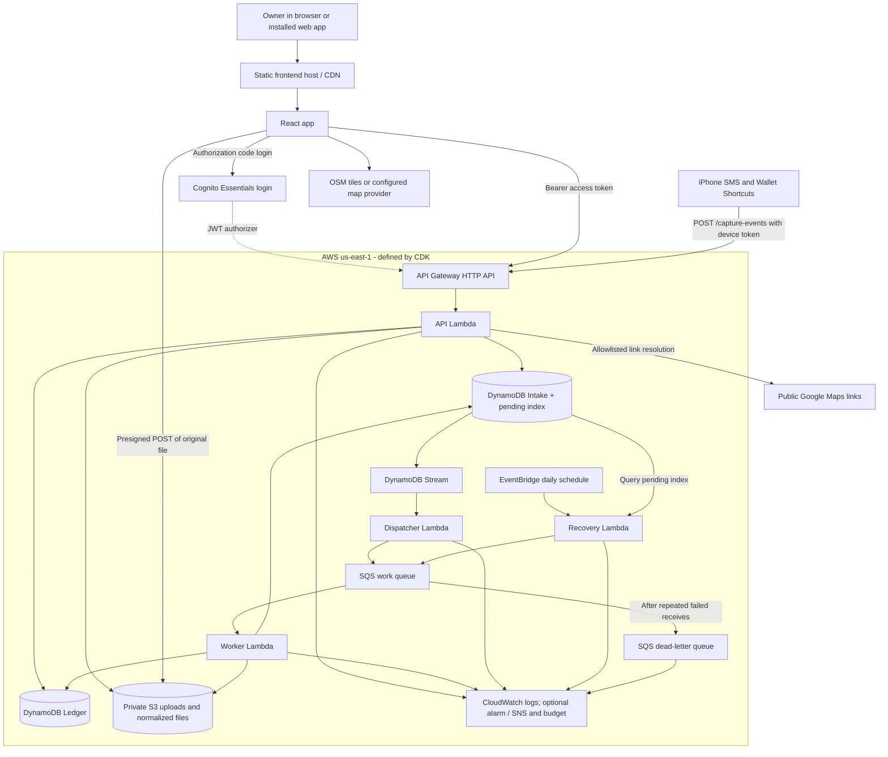
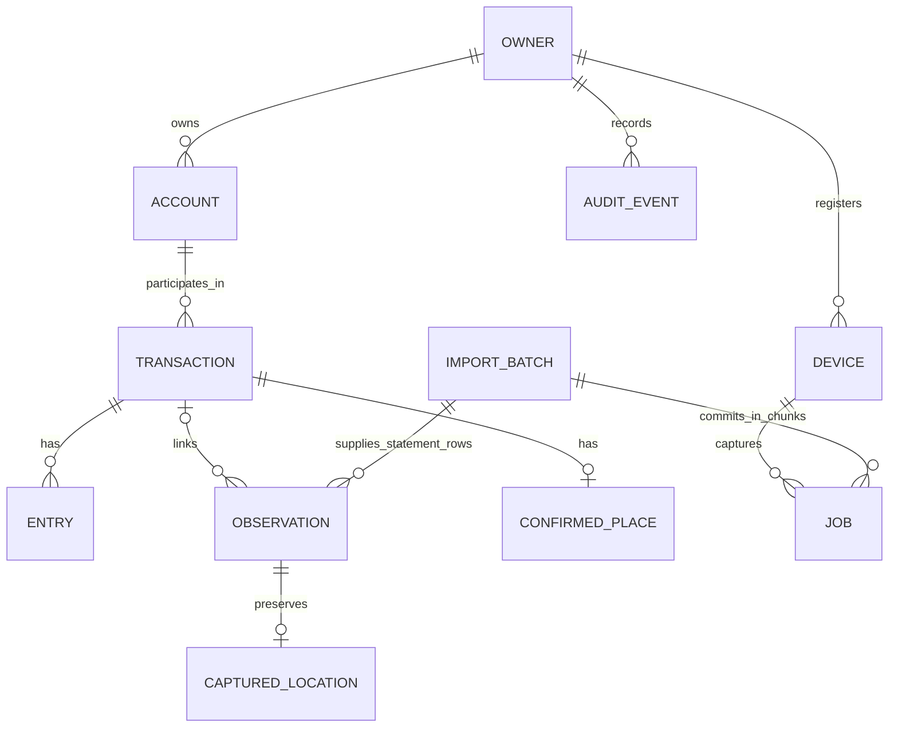

# Money Stalker architecture

Last reviewed: **2026-10-20**. This describes the implementation in this repository, not a verified inventory of deployed resources. No cloud account or deployment was inspected. Costs are monthly planning estimates in USD for AWS **us-east-1**, the region configured in `infra/app.ts`.

## 1. What the system does

Money Stalker is a Spanish personal-finance app for Colombia: COP amounts, America/Bogota financial dates, and an Accounts first interface. It combines manual movements, iPhone SMS/Wallet evidence, and CSV/XLSX statements into a canonical ledger. Evidence from multiple sources can describe one purchase; reconciliation prevents counting it repeatedly.

The frontend is an installable React 19 / TypeScript web app built by Vite. The backend is TypeScript on AWS Lambda, with DynamoDB for records and private S3 for statement files. AWS CDK defines the backend. Financial calculations and parsing run without an AI service.

## 2. System diagram

Solid arrows show request, data, or job flow. The dotted link represents JWT verification rather than an application data request.



The frontend host sits outside the CDK stack. `vercel.json` configures Vercel to build `dist/` with root base path `/`. Vite and CDK still contain GitHub Pages example defaults using `/money-stalker/`; they do not establish which host is live. The configured frontend root must match OAuth callback/logout URLs, CORS, and the Vite base path.

## 3. Code and responsibility map

| Area | Main files | Responsibility |
| --- | --- | --- |
| UI and design | `src/App.tsx`, `src/finance/`, `src/design-system/`, `DESIGN.md` | Accounts, review, reports, movement editing and shared visual system |
| Browser access | `src/auth.ts`, `src/api.ts` | Cognito login, session tokens, authenticated requests and exports |
| Financial rules | `domain/model.ts`, `domain/ledger.ts`, `domain/money.ts`, `domain/cash.ts`, `domain/merchant-rules.ts` | Validation, journal entries, reconciliation, balances and categorization |
| API use cases | `server/api.ts` | Ownership checks, movements, review, devices, import preview/commit and exports |
| AWS adapters | `server/handlers.ts`, `server/repository.ts`, `server/storage.ts` | HTTP/stream/queue handlers, persistence and file access |
| Processing | `server/processing.ts`, `server/sms.ts`, `server/imports.ts` | Capture parsing and classification; statement parsing and chunked commits |
| Location | `domain/location.ts`, `server/places.ts`, `src/finance/CaptureMap.tsx` | Optional location evidence, link verification and map rendering |
| Infrastructure | `infra/stack.ts`, `infra/app.ts` | Resources, permissions, retention, triggers, throttles and optional alerts |
| Local development | `server/local.ts`, `vite.config.ts` | Local adapters, development identity and Vite API proxy |
| Verification | `tests/`, `.github/workflows/checks.yml` | Domain/API/infrastructure tests, browser checks and build verification |

## 4. Phone capture: save first, process asynchronously

```mermaid
sequenceDiagram
  participant P as iPhone Shortcut
  participant A as API Lambda
  participant I as DynamoDB Intake
  participant D as Stream / Dispatcher
  participant Q as SQS
  participant W as Worker
  participant L as Ledger
  participant U as Web review
  P->>A: Device token + stable eventId + SMS/Wallet fields
  A->>I: Authenticate hashed token and check quota
  Note over A: Validate capture; reject security messages
  A->>I: Conditional insert of pending job + digest
  I-->>A: Durable write or matching existing job
  A-->>P: 202 durably_saved
  I->>D: New pending job via stream
  D->>Q: Household ID + job ID
  Q->>W: Deliver job, possibly more than once
  W->>I: Read job; skip if already done
  W->>L: Parse, reconcile and persist evidence / transaction
  W->>I: Mark done; remove pending index keys
  U->>A: Authenticated GET /state
  A->>L: Read household ledger
  A-->>U: Movements and review evidence
  Note over U: Resolve incomplete or ambiguous Shortcut evidence
```

- Shortcuts send original SMS text or verified Wallet automation fields, plus optional location, sample time and accuracy. Location failure must not prevent financial capture. Screenshots are parser references, not the normal SMS input.
- The API route intentionally bypasses Cognito JWT authorization; application code requires a revocable device token. Tokens are random, shown at creation, and stored as SHA-256 hashes. In AWS, each device is limited to 200 capture requests per UTC day, including retries.
- Jobs use `deviceId:eventId` and a payload digest. Reusing an ID with different data returns a conflict. Stable retries and domain observation IDs support idempotency; this is not an exactly-once transport.
- Security-message filtering runs before the capture payload is persisted. The authenticated device quota counter can still be updated for a rejected request.
- Workers parse and resolve account aliases, preserve location evidence and apply financial matching rules. Incomplete or ambiguous captures appear in Review; only SMS and Wallet captures enter that queue. See [Shortcut contract](docs/SHORTCUT_CAPTURE.md).
- AWS event source mappings can deliver duplicates, so handlers must remain idempotent. See [Lambda best practices](https://docs.aws.amazon.com/lambda/latest/dg/best-practices.html).

## 5. Statement import: preview before financial commit

```mermaid
sequenceDiagram
  participant B as Browser
  participant A as API Lambda
  participant S as Private S3
  participant I as DynamoDB Intake
  participant W as SQS / Worker
  participant L as Ledger
  B->>A: Create import: account, profile, filename, size
  A->>L: Snapshot IDs of existing non-deleted transactions
  A->>S: Save comparison IDs
  A->>I: Save uploading batch
  A-->>B: 5-minute presigned upload POST
  B->>S: Upload original CSV/XLSX directly
  B->>A: Request preview
  A->>S: Read original and comparison IDs
  A->>L: Read current state
  Note over A: Parse synchronously; compare only pre-upload transactions
  A->>S: Save normalized preview
  A->>I: Save preview batch status
  A-->>B: Preview rows and possible duplicates
  B->>A: Confirm rows and duplicate decisions
  A->>I: Save committing status and first import job
  I->>W: Stream dispatcher queues job
  W->>L: Commit at most 20 accepted rows per job
  W->>I: Save progress; enqueue continuation or finish
  B->>A: Poll batch status
```

Imports accept files up to 5 MiB. Parsing and preview creation run in the API Lambda; only the confirmed commit is queued. Equal rows within one file remain distinct because they may represent separate real movements. Possible duplicates are resolved in the preview, not Review. The comparison boundary is the set of transaction IDs captured before upload. Exports are generated by the API as CSV/XLSX and retain linked location evidence.

## 6. Data model, consistency and retention



This is a logical model, not SQL tables. In the personal release each verified Cognito `sub` owns one household; the server never trusts a client-provided household ID. Shared multi-user household membership is not implemented.

| Storage | Representation and behavior | Retention / recovery |
| --- | --- | --- |
| Ledger table | Partition `H#<subject>`; separate items for settings and domain records, plus `META` revision. Reads query the full partition with pagination. Mutations write only changed items in an atomic transaction guarded by the household revision; up to four attempts. | Retained on stack removal; 7-day point-in-time recovery (PITR). Movements use audited reversible soft deletion. |
| Intake table | Household jobs, device records and import batches; separate token-hash lookup and daily rate-counter items. `pending` index uses `workPk=PENDING` and a creation-time sort key. | Retained; 7-day PITR. Job TTL is 30 days from creation; rate-counter TTL is two days. Devices and batches have no TTL. DynamoDB TTL deletion is asynchronous. |
| S3 `original/` | Original statement files, private, TLS enforced, S3-managed encryption. Browser upload policies constrain size and encryption. | Expires after 30 days; incomplete multipart uploads aborted after one day. Bucket retained on stack removal. |
| S3 `normalized/` | Comparison IDs and parsed previews. | No expiration rule currently defined: storage accumulates. |
| Lambda logs | Four log groups. Application processing failures use safe error codes rather than raw financial payloads. | Seven-day retention; log groups destroyed on stack removal. |

COP amounts are integer minor-unit strings, calculated with integer arithmetic. Date-only financial dates remain separate from received timestamps and location timestamps. A credit purchase adds expense and card debt; paying the card reduces cash and debt as a transfer. Refunds reduce reported expense. Income, transfers, future dates and deleted movements are excluded from expense reports.

Raw financial captures can remain in Intake until TTL deletion; ledger observations preserve relevant evidence. The 30-day job TTL is not an app-wide privacy deletion policy, and PITR is not a tested disaster-recovery procedure. Original files are not versioned in this stack.

## 7. Runtime, security and operations

| Component | Configuration in `infra/stack.ts` |
| --- | --- |
| API / Worker / Dispatcher / Recovery | Node.js 22, ARM64, 512 MiB each; timeouts 29 / 60 / 30 / 60 seconds respectively |
| HTTP API | Exact frontend-origin CORS; global stage throttle 2 requests/second, burst 10; browser proxy routes require Cognito JWT and `openid` scope |
| Cognito | Essentials; owner-created users only, email login, optional TOTP MFA, no SMS MFA; public client with authorization code flow; 15-minute access/ID tokens and 7-day refresh token |
| SQS | Standard work queue, 6-minute visibility timeout, 4-day retention, DLQ after 3 receives; DLQ retention 14 days; managed encryption |
| Stream mapping | New pending INSERT records only; batch size 10, 3 retries, bisect on error and partial failure reporting |
| Worker mapping | SQS batch size 1 with partial failure reporting |
| Recovery | EventBridge once daily; query up to 100 pending jobs and resend them |
| Optional operations | If `budgetEmail` is supplied: account-wide USD 5 monthly budget with actual-spend alerts above USD 1 / 3 / 4; one DLQ alarm, SNS topic and email subscription |

The API and worker have read/write access to both tables and the file bucket. Dispatcher can send queue messages; Recovery can read Intake and send queue messages. There is no VPC, NAT gateway, dedicated server, RDS database, AWS-hosted frontend or provisioned Lambda concurrency in the stack.

Browser tokens live in `sessionStorage`. The PWA service worker caches selected static assets only; it does not cache navigations, OAuth callbacks, API responses or financial data. It is not an offline financial mutation queue. Phone automation retries depend on the configured Shortcut retaining the same event ID and payload. Hands-free reliability still requires the owner's [iOS device experiment](docs/IOS_CAPTURE_SPIKE.md).

Recovery is a fallback, not immediate redrive: it does not consume the DLQ, and repeatedly failing old jobs can occupy its first 100 results. A failed stream dispatch can therefore wait until the daily recovery. Budget alerts are notifications, not a spending cap.

Maps use MapLibre with public OpenStreetMap raster tiles by default, or `VITE_MAP_STYLE_URL`. Google Maps links are resolved with an allowlisted, bounded server fetch; current code does not call paid Places/geocoding APIs. The legacy Google key configuration does not imply current billable usage. Tile requests reveal the viewed area to the tile provider. OSM public tiles have a [usage policy](https://operations.osmfoundation.org/policies/tiles/) and no guaranteed capacity for product growth; budget for a suitable provider when needed.

## 8. Local development and verification

`npm run dev` runs the loopback API on port 8787 with `MemoryRepository` and `MemoryFiles`; it persists data to ignored `.local/state.json` unless `LOCAL_EPHEMERAL=1`. A local timer drains jobs every second instead of using AWS streams/SQS. `npm run dev:web` starts Vite, which proxies `/api` to the local server. Development uses a fixed local identity and must never be exposed as a production API.

The CI workflow runs the secret scan, typecheck, unit tests, build, offline CDK synthesis and Playwright tests. `tests/infra.test.ts` asserts privacy/auth/cost safeguards. No CI deployment job is defined here; hosting integrations can exist outside the repository.

**Release boundary:** changes and verification stay local. The owner handles every deployment and remote push under the rules in [AGENTS.md](AGENTS.md). Architecture documentation maintenance never authorizes deployment, deployment-status checks or remote pushes.

## 9. Monthly service cost estimates

### Scope and rates

Pricing references reviewed on **2026-10-20**. These are rounded public list-rate planning inputs, not billing measurements or a quote. No promotional credits or general AWS free allowances are deducted in the tables below, **except Cognito's direct-sign-in allowance**, which is explicitly modeled. Allowances can be shared with other workloads. Actual invoices depend on account eligibility, region, usage, tax and current rates.

| Service | Planning rate / cost driver | Official reference |
| --- | --- | --- |
| API Gateway HTTP API | USD 1 per million requests at this volume; large requests can consume multiple billing units | [API Gateway pricing](https://aws.amazon.com/api-gateway/pricing/) |
| Lambda ARM64 | USD 0.20 per million invocations + USD 0.0000133334 per GB-second | [Lambda pricing](https://aws.amazon.com/lambda/pricing/) |
| DynamoDB Standard on-demand | USD 0.625 per million write request units (WRU), USD 0.125 per million read request units (RRU) | [DynamoDB pricing](https://aws.amazon.com/dynamodb/pricing/) |
| DynamoDB storage and PITR | USD 0.25 per GB-month storage + USD 0.20 per protected GB-month; both tables and index storage matter | [DynamoDB pricing](https://aws.amazon.com/dynamodb/pricing/) |
| S3 Standard | USD 0.023 per GB-month, USD 0.005 per 1,000 PUT/POST and USD 0.0004 per 1,000 GET | [S3 pricing](https://aws.amazon.com/s3/pricing/) |
| SQS Standard | USD 0.40 per million request units, including sends, receives, deletes, empty polls and retries | [SQS pricing](https://aws.amazon.com/sqs/pricing/) |
| CloudWatch | USD 0.50 per GB log ingestion, USD 0.03 per GB-month stored logs, USD 0.10 for one standard alarm | [CloudWatch pricing](https://aws.amazon.com/cloudwatch/pricing/) |
| Cognito Essentials | USD 0.015 per active direct-sign-in user above 10,000 MAU; modeled allowance must be available to this app | [Cognito pricing](https://aws.amazon.com/cognito/pricing/) |
| Internet transfer | USD 0.09 per GB placeholder before applicable allowances; exclude frontend CDN bytes from this AWS line | [AWS transfer pricing](https://aws.amazon.com/ec2/pricing/on-demand/#Data_Transfer) |
| EventBridge, SNS, Budgets | Daily schedule and occasional email alerts: negligible in this model; reserve USD 0–1/month for routine control-plane usage | [EventBridge](https://aws.amazon.com/eventbridge/pricing/), [SNS](https://aws.amazon.com/sns/pricing/), [Budgets](https://aws.amazon.com/aws-cost-management/aws-budgets/pricing/) |

DynamoDB units are not API calls: item size, consistent reads, transactional writes and index writes affect consumption. The workload below specifies billed units including those effects. Seven-day PITR does not mean paying for just seven days of protected storage per month.

### Explicit workload assumptions

Let `N` be monthly active users, each with a separate household. This is an illustrative moderate-use workload, not measured traffic or a capacity promise. Registered inactive users can still retain data; if that population is large, storage must be modeled separately.

| Monthly usage | Per active user unless stated otherwise |
| --- | --- |
| Activity context | Roughly 200 captures, 2 statement files and regular dashboard/review sessions |
| HTTP API requests | 1,000, including capture, UI reads, polling and imports |
| Lambda | 1,500 invocations across all four functions; 0.2 seconds average at 0.5 GB = 150 GB-seconds; add 30 recovery invocations / 3 GB-seconds globally |
| DynamoDB requests | 4,000 billed WRU and 100,000 billed RRU, including ledger snapshots, transactions and pending-index work |
| DynamoDB storage / PITR | 0.01 GB combined table/index storage and 0.01 GB protected table data; representative retained footprint, not new data each month |
| S3 | 0.02 GB average retained footprint; 10 PUT/POST and 100 GET requests; includes normalized files |
| SQS | 1,000 request units; add 300,000 globally as an illustrative allowance for idle polling |
| Logs | 0.005 GB ingested and 0.001 GB average stored; one global alarm |
| AWS internet transfer | 0.02 GB outbound |

The assumed 0.2-second Lambda average must be replaced with measurements: synchronous XLSX parsing, full ledger reads and cold starts can exceed it. Storage footprints are a snapshot assumption; retained ledger history and `normalized/` files grow over time.

### Per-service growth model

USD/month, rounded independently; `<0.01` means a positive amount below one cent. Cognito includes the available 10,000-MAU direct-sign-in allowance. Other rows use gross rates before allowances.

| Service | 1 user | 100 users | 1,000 users | 10,000 users | 100,000 users |
| --- | ---: | ---: | ---: | ---: | ---: |
| HTTP API | <0.01 | 0.10 | 1.00 | 10.00 | 100.00 |
| Lambda | <0.01 | 0.23 | 2.30 | 23.00 | 230.00 |
| DynamoDB requests | 0.02 | 1.50 | 15.00 | 150.00 | 1,500.00 |
| DynamoDB storage + PITR | <0.01 | 0.45 | 4.50 | 45.00 | 450.00 |
| S3 | <0.01 | 0.06 | 0.55 | 5.50 | 55.00 |
| SQS, including polling allowance | 0.12 | 0.16 | 0.52 | 4.12 | 40.12 |
| CloudWatch logs + alarm | 0.10 | 0.35 | 2.63 | 25.40 | 253.10 |
| AWS transfer placeholder | <0.01 | 0.18 | 1.80 | 18.00 | 180.00 |
| Cognito Essentials | 0.00 | 0.00 | 0.00 | 0.00 | 1,350.00 |
| **AWS modeled subtotal** | **0.25** | **3.03** | **28.30** | **281.02** | **4,158.22** |

To reproduce the subtotal with these inputs:

```text
AWS(N) = 0.220046 + 0.02808001 × N + 0.015 × max(0, N - 10000)
Planning reserve = AWS(N) × 1.5 + USD 1 for routine control-plane usage
```

The 50% reserve covers ordinary estimation uncertainty, not outages, abuse, major restores or a change in usage pattern. If Cognito's allowance is unavailable, replace its term with `0.015 × N` (up to USD 150/month more at these sizes). General free allowances can reduce the remaining bill materially; they are intentionally not required for the model.

### Frontend, maps and total planning budget

[Vercel pricing](https://vercel.com/pricing) lists Hobby at USD 0 and Pro from USD 20/month with one developer seat; extra usage and seats can add costs. [Hobby is for personal, non-commercial use](https://vercel.com/docs/plans/hobby). Growth alone does not establish plan eligibility or included bandwidth. The following budgets assume Hobby for the one-person pilot and a USD 20 Pro base for the other scenarios, before hosting overages. This is a scenario choice, not a statement about the current account.

| Monthly budget | 1 user | 100 users | 1,000 users | 10,000 users | 100,000 users |
| --- | ---: | ---: | ---: | ---: | ---: |
| AWS subtotal | 0.25 | 3.03 | 28.30 | 281.02 | 4,158.22 |
| Assumed frontend base | 0.00 | 20.00 | 20.00 | 20.00 | 20.00 |
| **Base estimate before tax and extras** | **0.25** | **23.03** | **48.30** | **301.02** | **4,178.22** |
| **Planning budget: AWS × 1.5 + USD 1 + frontend base** | **1.37** | **25.54** | **63.45** | **442.53** | **6,258.33** |

Maps cost USD 0 in the small default public-tile scenario, subject to provider policy and availability. A paid tile provider is an **unpriced addition** for growth, not assumed free at 100,000 users. Estimate it as `map sessions × average tile requests per session × provider unit rate`, plus any plan minimum. Frontend CDN traffic/requests, build usage, extra seats, domains, DNS, support, email delivery beyond included service behavior, backup restores and retained CDK bootstrap artifacts are also excluded or unmeasured additions. Thus the large-user totals are a baseline, not an all-inclusive production quote.

Prices are USD before tax. To budget COP, multiply by the exchange rate used by the payment provider and applicable taxes/fees; no fixed FX rate or tax treatment is assumed. The household target of less than USD 5/month is plausible for the pilot under these assumptions, not guaranteed.

`scripts/cost.ts` / `npm run cost` is an older independent pilot illustration: it assumes GitHub Pages, different usage and a generic Lambda compute rate. Its output does not reproduce these tables. Use the explicit model above for this document until that script is deliberately aligned.

## 10. What must change before larger-scale use

The cost scenarios show arithmetic under fixed assumptions, not that this pilot supports those user counts today.

| Current constraint | Consequence and next design step |
| --- | --- |
| API global throttle: 2 requests/second, burst 10 | Only about 5.18 million requests per 30-day month at a perfectly steady rate. At 1,000 requests/user/month, 10,000 and 100,000 users exceed even average throughput; bursts can hurt much earlier. Revisit throttles, abuse controls and load tests before growth. |
| Full household snapshot on reads and mutations | Read cost, latency and response sizes increase with each household's history. At 10× the modeled RRU, DynamoDB request costs rise from USD 15 to USD 127.50 per 1,000 users. Introduce targeted reads, API pagination and incremental report summaries. |
| Pilot query guard above 30,000 records; at most 95 changed/deleted items per mutation | Per-record storage avoids a single giant household item, but histories and bulk operations remain bounded. Keep imports chunked and design archival/pagination before those limits. |
| One household revision for all mutations | Parallel captures/imports/reviews can conflict and retry. Measure contention and consider narrower transaction boundaries while preserving ledger invariants. |
| One `PENDING` index partition; recovery reads only 100 jobs/day | Backlog and poisoned jobs can starve recovery. Add pagination, retry backoff, age/error metrics and an owner-operated DLQ procedure; shard pending work if measurements justify it. |
| API parses imports synchronously within 29 seconds | Larger/complex spreadsheets can time out despite the size limit. Measure worst cases; move preview parsing to background jobs if needed. |
| No Lambda reserved concurrency | Queue bursts can consume account concurrency. Set and test suitable limits, retries and alarms as part of a future capacity change. |
| One Cognito user equals one household; signup disabled | Public onboarding and shared household access require membership/authorization design, not just enabling signup. |
| Normalized objects and financial history accumulate | Recalculate retained storage by cohort age, not only MAU. Define an explicit retention/export policy consistent with audit and privacy needs. |
| Public tiles and bounded Google link HTML parsing | Tile capacity is external; link resolution can break when upstream pages change. Preserve manual coordinates as fallback and select a suitable tile service before high usage. |

## 11. Keeping this document current

Update this file in the same change whenever infrastructure, hosting, authentication, storage, queues, schedules, retention, networking, external services, operational controls or scaling assumptions change. Update affected diagrams, source references, service costs and growth tables; date pricing checks and state when inputs are estimates. See the mandatory maintenance rule in [AGENTS.md](AGENTS.md).
