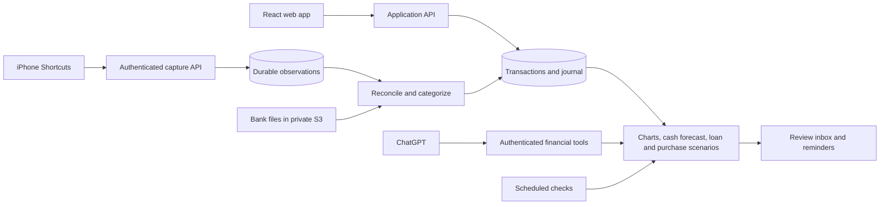

# Money Stalker — initial product and implementation plan

Prepared October 17, 2026. This is a proposed implementation plan, not a claim that the integrations have been tested. The repository was empty when planning started.

## 1. Product direction

Build a personal finance assistant that captures evidence when spending happens, reconciles it with official records, and explains what that spending means for upcoming obligations.

The main success measure is **how little work it takes to keep trustworthy records**. Attractive charts matter, but the product fails if maintaining them requires the same discipline as the old spreadsheet.

Start with Colombia, COP, Spanish merchant descriptions, and America/Bogota dates. Support one user first, then two separate logins with shared household views. Keep the core usable without a language model.

The confirmed budget is **under US$5 per month**, aiming for free allowances. Prefer AWS and React because they fit the owner's experience. Native iOS distribution, commercial bank connectivity, and a public launch have separate cost gates.

Initial product outcomes:

- Import an original bank file without deleting its headers, totals, or unwanted columns manually.
- Capture enough context at purchase time to remember an otherwise obscure Bre-B or Nequi payment.
- See one purchase even if Wallet, an SMS, and a later statement all describe it.
- Know how much cash is already committed to cards and bills before spending more.
- Manage mortgages in UVR and pesos as first-class products, and compare prepayment/refinancing scenarios using actual loan terms.
- Evaluate major purchases and new loans against household cash flow, including replacing a Mazda 3 with a 2024 Subaru Crosstrek.
- Ask financial questions through an exported summary or authenticated ChatGPT integration, without requiring a paid model inside Money Stalker.
- Export all financial records to CSV and Excel, including categories and reconciled status.

The owner clarified that the card problem is **spending more than can comfortably be repaid**, not missing payment dates: closing dates are around mid-month and payment dates near the beginning of the month, which obscures how much income has already been spent. Card-spending visibility therefore belongs in the first useful release.

Working assumptions still to confirm: exact iPhone/iOS version, income dates, exact account/card products and cycle dates, and mortgage amortization system. These do not prevent planning, but they affect implementation tests.

## 2. Capture feasibility determines the first milestone

| Source | Proposed route | What must be verified |
| --- | --- | --- |
| Bancolombia / Nequi bank files | Upload unchanged CSV; support XLSX where actual samples require it | Encoding, delimiters, dates, amount signs, repeated headers, available transaction IDs |
| Apple Wallet card taps | User-configured Shortcuts transaction automation calls our capture endpoint | Actual fields supplied for each card, locked-phone behavior, physical versus online payments, any Watch usage |
| Bank SMS | Shortcuts Message automation filtered to bank messages | Sender matching, access to message content, execution without confirmation, exclusion of OTP/security messages |
| Bank app push notifications | Conditional Shortcuts Notification automation | Availability on the installed iOS version, readable payload, privacy settings, execution behavior |
| Cash / unclear transfer | Quick capture shortcut or web form, with an optional note | A few seconds of work; usable without a merchant name |
| Direct bank sync | Later, an approved account-information API | Product coverage, production eligibility, consent flow, cost, refresh limits |

Apple documents both [Wallet transaction triggers](https://support.apple.com/guide/shortcuts/apd65c67538a/ios) and [message triggers](https://support.apple.com/guide/shortcuts/apdd711f9dff/ios). Its guide lists Message and Transaction among [automations that can run without asking](https://support.apple.com/guide/shortcuts/apd602971e63/ios). This establishes a promising route, not guaranteed capture on the user's cards.

The current Apple guide, with an iOS 27 version option, also documents a Notification trigger that filters by app and notification text. The [iOS 26 version](https://support.apple.com/guide/shortcuts/apd932ff833f/9.0/ios/26) does not document that trigger. Treat notification capture as conditional until the actual phone is tested. Do not assume the app itself gets unrestricted access to other apps' notifications. [Apple event triggers](https://support.apple.com/guide/shortcuts/apd932ff833f/ios)

FinanceKit is not our Colombian bank integration: Apple's published eligibility currently covers specified US products and UK institutions, not Bancolombia or Nequi. Apple's default-carrier SMS framework also requires an EU account and location, so it is not a route for this Colombian app. [FinanceKit availability](https://developer.apple.com/financekit/), [TelephonyMessagingKit restrictions](https://developer.apple.com/documentation/TelephonyMessagingKit)

Bancolombia does offer an Open Finance Account Information product for consented savings/current accounts, including transactions. Its catalog advertises a free sandbox and production access by quotation. This is worth investigating later; it does not establish free production access, credit-card coverage, or Nequi coverage. Nequi consumer-history access remains unverified. [Bancolombia Account Information](https://api-portal-external.apps.bancolombia.com/documentacion/categorizacion/publicos/open-finance/account-information)

**Location is supporting evidence.** Store the time, accuracy, and origin of a location sample. A delayed SMS can arrive after leaving a shop; a home location can accompany an online order; many shops share one mall. Missing location must never prevent saving a transaction. Use one-time capture with consent, not continuous tracking. Initially, user-confirmed places and nearby past purchases avoid a paid maps API.

Personal automations require setup on each phone; Apple says they do not sync between devices. Include a setup walkthrough and a test transaction. [Apple personal automations](https://support.apple.com/guide/shortcuts/apd690170742/ios)

The detailed experiment is in [IOS_CAPTURE_SPIKE.md](IOS_CAPTURE_SPIKE.md). A native app may improve local persistence and Shortcuts actions later, but cannot be assumed to bypass operating-system restrictions.

## 3. The first useful experience

The home screen should answer four questions:

1. What needs attention? Unmatched purchases, uncertain categories, approaching payments, and stale account data.
2. How much is already committed? All unpaid card purchases, including unbilled ones, mortgage, bills, and a chosen cash reserve. Show the income-budget cycle beside the card's statement cycle.
3. Where did the money go? Monthly income/expenses, category trends, account balances, and merchant history.
4. What changed? A small number of actionable observations with the underlying transactions attached.

The daily experience is mostly automatic capture. The weekly experience is a short review inbox. The monthly experience is importing a statement and resolving exceptions. The first release must already show when each account was last reconciled and which totals include provisional observations.

Use a forgiving workflow: uncertain merchants can remain unresolved while the amount is counted provisionally. An explicit “unknown” is more useful than a confident wrong category. Aim for a median weekly review below five minutes after the first month of setup; measure this with real usage.

## 4. Data model and financial correctness

Separate **source observations** from **financial transactions**. A bank message is evidence of a transaction; it is not automatically another expense.

| Record | Responsibility |
| --- | --- |
| User, household, membership | Identity, ownership, access to shared accounts |
| Account and balance snapshot | Savings, Nequi, cash, credit cards, mortgage; opening balance and reconciliation date |
| Import batch / source observation | Original source, file/row reference or device event ID, parser version, original text, received time |
| Transaction | Canonical amount, currency, purchase date, posting date, status, merchant, category, provenance |
| Journal entry and postings | Balanced financial effects, transfers, liabilities, adjustments and corrections |
| Merchant alias and categorization rule | User-confirmed mappings, scope, confidence, correction history |
| Recurring obligation | Expected amount/range, confirmed due date, reminder settings, payment match |
| Card statement / installment plan | Statement period, due date, required payment, purchases and future installments |
| Loan and repayment schedule | Product type, denomination/indexation, rate convention, amortization system, historical payments; UVR and peso mortgages plus vehicle loans |
| Asset, quote and decision scenario | Existing vehicle value/debt, proposed purchase, dated quotes, financing and ownership costs, explicit future assumptions |

Use a small double-entry journal internally while keeping the interface familiar. A card purchase creates an expense and a liability. Paying that card reduces cash and the liability; it does not create another expense. Moving money from Bancolombia to your own Nequi is a transfer. Paying a merchant through Nequi is an expense. An unfamiliar recipient may require review.

Preserve split purchases, refunds, reversals, card fees, interest, and opening balances. Distinguish mortgage principal reduction from interest and insurance expenses. Cash withdrawals move money into a cash account; later cash purchases create expenses.

Store money in integer minor units or exact decimal strings, never binary floating-point arithmetic. UVR quantities/rates need higher fixed precision and the lender's rounding rules. Keep date-only statement fields as dates rather than inventing midnight timestamps. Preserve transaction time, posting date, and received time separately.

Financial corrections create traceable adjustments/revisions. Category and merchant corrections can be edited with an audit trail. Keep original evidence under a retention policy; “traceable” must not mean personal data can never be deleted.

## 5. Import and deduplication

The pipeline is: receive → preserve source → parse → normalize → reconcile → categorize → publish totals.

**Files:** recognize known bank layouts, offer a saved column mapping for unfamiliar layouts, preview the result, and explain rejected rows. Handle Colombian number formats, Excel encodings, semicolons, decimal separators, and day/month dates. Keep the original file in private storage for a bounded period. Formula-like descriptions must be exported safely so a merchant string cannot become an executable spreadsheet formula.

**Repeated delivery:** use durable source/device event IDs and conditional writes. Re-uploading an identical file is detected using its content hash within the relevant user/account. Queue retries and device retries must keep the original event ID. A database client's short-lived retry token is not sufficient for an import repeated next month.

**The same transaction across sources:** match stable bank references first. Otherwise generate candidates using account/card identity, direction, currency, amount, merchant/recipient clues, and source-specific purchase-to-posting date windows. Apple Pay device-card identifiers may need an explicit mapping to the actual card account.

Use high-confidence, unambiguous matches automatically; put uncertain candidates in review. Matching must be one-to-one within an overlapping statement period, preserving multiplicity. Two identical purchases at the same shop on the same day are two purchases unless there is stronger evidence otherwise. Row order or amount/date alone is not a safe identity.

Example: Wallet captures COP 35,000 and a location. An SMS describes the same purchase. The statement later posts it under a different merchant descriptor. The result is one canonical purchase with three observations. The statement confirms the posted amount/date; the user's merchant name and category remain. A genuinely conflicting final amount, currency conversion, partial capture, or refund requires dedicated handling rather than a silent merge.

Keep capture confidence separate from posting status. A phone observation can be unmatched; a bank statement can confirm posting; a reversal can link to an earlier purchase. A missing statement match is not proof that a purchase was canceled.

Before release, validate at least these cases:

- Same file imported twice; overlapping files; reordered/edited exports.
- Two equal purchases; delayed posting across a month boundary; pending-to-posted amount changes.
- Wallet plus SMS plus statement for one purchase.
- Own-account transfer, card repayment, split purchase, partial refund and reversal.
- Concurrent imports and retries after a crash; undoing a mistaken match.

Target zero false automatic merges in the labeled validation set; record auto-match precision and unresolved cases during real use. Do not claim zero duplicates in all future data.

## 6. Categorization that learns economically

Use explicit rules before model calls:

1. The user's correction for this purchase.
2. A confirmed merchant/recipient alias and category rule.
3. Normalized merchant text and established household history.
4. Location/time clues as supporting signals.
5. Optional model suggestion for unresolved cases.

For example, confirmed aliases such as `MC DONALS`, `MCDONALDS`, and a bank-specific descriptor can map to one merchant. A correction offers “apply to this purchase” or “remember for this merchant.” Grocery-store purchases and person-to-person payments may have different purposes, so rules must remain editable and scoped.

Record why a category was suggested. High-confidence confirmed rules can apply automatically; uncertain suggestions enter the inbox. Learning initially means storing useful corrections, not training a model. Avoid sharing personal merchant/location histories between unrelated households.

## 7. Credit cards and bills

The primary behavior is to make a card purchase consume the spending budget immediately. A purchase on either side of the closing date has the same immediate effect on available spending, even if its payment falls in a different statement cycle. The closing date schedules repayment; it does not reset the household's budget.

Introduce a card-payment reserve in phase 1. Each purchase increases the amount of existing cash committed to repaying cards. Show billed debt, unbilled debt, cash reserved for both, and any unfunded difference. When the card is paid, reduce cash and the corresponding reserve together so the payment does not consume the budget a second time.

The main “available to spend” figure subtracts outstanding card commitments, essential unpaid bills before the next income date, and the chosen safety reserve from current reconciled liquid cash, with disjoint buckets to avoid subtracting the same commitment twice. Future income appears in a separate projection, not as cash already available. If the result is negative or the data is incomplete, show that explicitly. For example, purely illustratively: COP 3,000,000 cash minus COP 1,500,000 card commitments, COP 500,000 upcoming bills, and COP 300,000 reserve leaves COP 700,000 available.

Give the owner a configurable budget tied to actual income dates, plus calendar-month and card-cycle views. Show “you have committed X of this income period's budget” and an early warning when a chosen threshold is crossed. This protects against spending nearly the entire salary before the next statement becomes visible.

Track card closing date, payment due date, statement balance, minimum due, paid amount, current unbilled purchases, and the full-payment target required by the actual product terms. One cuota does not justify hardcoding an interest-free assumption; use the card agreement and statement.

Separate three alerts:

- **Upcoming payment:** a confirmed amount is due soon.
- **Affordability risk:** projected cash cannot cover scheduled obligations while preserving the user's reserve.
- **Possible missed payment:** a due date passed without a matching payment in sufficiently current data. If the account is stale, say “payment not confirmed,” not “you are overdue.”

Build a dated cash-flow forecast through the next income date and the next card due dates. Start from reconciled liquid balances, subtract unpaid obligations on their expected dates, add only suitably reliable expected income, and apply a reserve. Show the lowest projected balance and the assumptions. Do not count card capacity as available cash. Do not subtract both a card purchase and its repayment from the same cash forecast; the purchase affects spending and the repayment affects cash timing.

If the next salary covers the card but leaves no room for bills, the app should explain that conflict. Alerts should identify a concrete shortfall and the spending categories contributing to it, with configurable limits and a digest to avoid notification fatigue.

For utilities, subscriptions, administration fees, and mortgage payments, let the user enter schedules immediately. After repeated matching payments, suggest recurring obligations and amount ranges. A historical payment date is not necessarily a due date: require confirmation from the user or a bill. Link an actual payment to the obligation to suppress duplicate reminders.

Start with an in-app inbox and web push after permission. Apple supports push for Home Screen web apps on iOS 16.4 and later. Test real delivery and show upcoming obligations in the app even if push is disabled. [Apple web push documentation](https://developer.apple.com/documentation/usernotifications/sending-web-push-notifications-in-web-apps-and-browsers)

## 8. Mortgages, loans and purchase decisions

Build a shared loan engine, with separate product rules and schedules. UVR is a denomination/indexation mechanism, not the name of the whole module. Mortgages in pesos must be supported directly, including onboarding, balances, statement reconciliation, schedules and extra payments; they are not only a refinancing destination.

Start with the real contract and recent statements: loan product, denomination (COP or UVR), outstanding principal and balance date, interest rate and convention, amortization system, remaining term, payment dates, insurance, fees, subsidies if relevant, and previous extra payments.

| Mortgage type | Calculation and display |
| --- | --- |
| Pesos (COP) | Principal and amortization in COP using the contracted rate/schedule; principal-and-interest installments separate from potentially changing insurance/fees |
| UVR | Principal and amortization in UVR with dated official conversion to COP; future COP amounts depend on explicit UVR/inflation scenarios |

For a standard fixed-rate, constant-payment peso mortgage, the principal-and-interest installment is constant under its contract; this does not mean every insurance premium or the total debit can never change. Store the actual product terms rather than hardcoding all loans to one schedule. Bancolombia documents peso and UVR housing-credit alternatives. [Bancolombia housing credit](https://www.bancolombia.com/personas/creditos/vivienda/credito-hipotecario-para-comprar-vivienda)

For UVR mortgages, keep both views visible:

`principal in COP on date d = outstanding UVR principal × official COP value of one UVR on d`

UVR reflects IPC using the official daily methodology; it is not just an annual percentage added to a peso loan. Use Banco de la República's published historical UVR values with dates and provenance. Show data freshness and stop calling a cached value “today's” when an update fails. [Banco de la República: UVR](https://banrep.gov.co/es/glosario/uvr)

The simulation must reproduce the lender's amortization method and interest/day-count/rounding conventions. For a monthly-period model with an effective annual rate, the equivalent monthly rate is `(1 + EA)^(1/12) - 1`; use another convention if the contract requires it. Insurance and fees remain separate. Apply historical payments on their actual dates before simulating the future.

Compare:

- The current payment schedule.
- A fixed extra monthly payment.
- An occasional lump sum.
- Extra principal payments with term reduction versus installment reduction.
- Refinancing or switching between UVR and pesos using actual dated quotes, remaining principal, new term, insurance and switching costs.

For each, show projected payoff date, interest, insurance/fees, total nominal COP payments, and the effect on the cash reserve. Use low/base/high future inflation paths labeled as assumptions, not predictions. Compare strategies using the same inflation path and clearly specified cash budget; show what happens to cash freed by a lower installment.

For qualifying housing loans, the SFC describes partial/total prepayment without penalty and the borrower's choice between reducing term and installment. Confirm the particular product and bank procedure, and distinguish a principal prepayment from paying future installments in advance. [SFC housing-credit instructions](https://www.superfinanciera.gov.co/publicaciones/18138/documento-sin-t-iacute-tulo-18138/)

The app should not announce a universal “best” strategy. It should compare the user's options under explicit assumptions, including competing card obligations and liquidity needs. Release each mortgage implementation only after reproducing at least two known statement or lender-schedule periods within documented rounding tolerances. Use anonymized real or lender-provided peso examples if the owner's own mortgage is only in UVR. The financial engine calculates; an optional assistant explains its results.

### Vehicle and other purchase decisions

Support the question: “We own a Mazda 3 and want a Subaru Crosstrek 2024. Can our finances support financing the change?” Ask for missing price/quote inputs and use permitted household records to calculate affordability. Do not invent a car valuation, loan offer, credit score, or approval probability.

Compare keeping the Mazda, selling/trading it for the Subaru, buying while keeping both, and waiting to build a larger down payment. Include net sale proceeds after existing debt and selling costs, cash down payment, new loan terms, upfront costs, and ongoing ownership costs. Model insurance, SOAT, taxes, maintenance, fuel and parking, using dated estimates or quotes. When replacing the Mazda, account for the change in existing vehicle costs rather than adding both vehicles' full costs.

Show upfront cash required, monthly installment, total financing cost, cash left after obligations, reserve remaining, maximum affordable financing under the selected assumptions, and stress cases such as reduced income, unexpected repair costs or higher UVR payments. Do not count card purchases and repayments twice. Income/spending history must be current and representative; missing or seasonal data lowers confidence.

Separate “fits our household budget” from “the bank will approve it.” The latter depends on the lender's underwriting and verified credit information. A longer term can lower the installment while increasing total cost; show both. The app can calculate all this without a language model. [Bancolombia vehicle-credit cost considerations](https://blog.bancolombia.com/vida-cotidiana/cuanto-credito-necesitas-para-comprar-carro-calcula-tu-cuota-gmcv/)

Detailed inputs, calculation boundaries, response structure and ChatGPT integration are specified in [DECISIONS_AND_CHATGPT.md](DECISIONS_AND_CHATGPT.md).

## 9. Recommended architecture under US$5/month

Use one TypeScript codebase with separate domain modules, a web app, and a few Lambda entry points. Avoid a large service architecture.

| Layer | Initial choice | Reason |
| --- | --- | --- |
| UI | React + TypeScript + Vite, responsive installable web app | Familiar stack; static hosting; desktop imports and phone review |
| Hosting | Private S3 origin + CloudFront Free plan, if account eligible | Minimal operating cost; generated domain initially |
| Authentication | Cognito Lite/Essentials with direct sign-in; TOTP where configured | Separate identities; avoid paid SMS authentication |
| API | API Gateway HTTP API + Node.js/TypeScript Lambda | Small usage-based workload |
| Database | DynamoDB on-demand | No continuously running database; fits a few household access patterns |
| Uploaded files | Separate private S3 storage | Restricted temporary upload/download URLs and lifecycle deletion |
| Background processing | SQS + one worker + failed-job queue | Retriable imports and processing with persistent deduplication |
| Scheduling | EventBridge Scheduler | A small number of daily jobs for obligations and UVR refresh |
| Infrastructure | AWS CDK in TypeScript | Reproducible deployment and scoped permissions |
| Conversational interface | Financial-summary export first; authenticated remote MCP tools for ChatGPT later | ChatGPT calls our deterministic financial functions; no model API call required in our backend |
| Optional embedded language model | Provider API behind our own quota | Deferred; separate from the ChatGPT integration |

Vite produces static deployment assets, which suits this authenticated app. Server rendering offers little value for the initial private dashboard. CDK supports scoped resource grants. These choices were checked using Context7. [Vite static deployment](https://vite.dev/guide/static-deploy.html), [AWS CDK best practices](https://docs.aws.amazon.com/cdk/v2/guide/best-practices.html)

The diagram shows responsibilities, not separate microservices. Persist capture and a processing marker atomically before acknowledging receipt; a DynamoDB stream can enqueue work. Retries reuse event IDs, and a recovery job detects observations left unprocessed. SQS alone must not be the permanent record of a purchase.

For DynamoDB, define the actual reads before choosing keys: transactions by account/date; household review queue; matching candidates by account/amount/date; merchant aliases; bills by due date. Use a few comprehensible tables and indexes. Enforce balanced journal writes and permanent idempotency keys in one conditional transaction. Monthly summaries can be rebuilt from the journal and must carry a freshness/version marker. Never scan every household to render one user's chart.

DynamoDB supports atomic multi-item transactions, but its built-in request-token idempotency lasts only ten minutes. Persistent application keys are necessary. [AWS transaction behavior](https://docs.aws.amazon.com/amazondynamodb/latest/developerguide/transaction-apis.html)

**Tradeoff:** PostgreSQL would make joins, evolving reports, and relational constraints easier. DynamoDB wins here on the strict budget and AWS preference, at the cost of more deliberate access-pattern design and application-enforced invariants. Before implementing the ledger, prove the required queries and reconciliation writes against a realistic sample. Reconsider PostgreSQL if those become convoluted; migrating a financial ledger later is a real project, not a free switch.

Aurora can auto-pause to zero on supported versions, but resume commonly takes about 15 seconds, storage still costs money, and active connections can prevent pausing. It is not the default for this budget. A managed Postgres free tier remains an alternative if SQL materially reduces development effort and its limits, backups, and privacy terms are acceptable. [Aurora auto-pause](https://docs.aws.amazon.com/AmazonRDS/latest/AuroraUserGuide/aurora-serverless-v2-auto-pause.html)

Use one region initially, with us-east-1 as a pricing baseline. Confirm regional availability and cross-border processing before deployment. Domain logic stays independent of AWS handlers so imports, forecasts, loan calculations and purchase scenarios can be tested locally. The web app and ChatGPT tools call the same functions with the same authorized data and assumptions.

## 10. Cost envelope and controls

The target is **US$0–3/month for household use**, leaving headroom below US$5. This is an engineering target, not a guaranteed AWS bill. Do not depend on temporary signup credits or assume all free allowances are unused by other projects in the same account.

Illustrative workload: two users, up to 1,000 financial transactions/month, several observations per transaction, 10,000 API requests, 20,000 small Lambda invocations, and less than 1 GB of retained files. Price again before provisioning.

| Component | Initial allowance / estimate |
| --- | --- |
| Static frontend | US$0 CloudFront Free plan if eligible; confirm included limits and S3 credits |
| API + compute + database requests | Roughly US$0.15 for the example below before free allowances; allow extra for retries and processing |
| Storage, backups, queues, logs and scheduling | Reserve US$0.50–1.50/month; validate with actual retention and usage |
| Authentication | Expected US$0 for two direct-sign-in users under the applicable Cognito allowance |
| ChatGPT integration | No Money Stalker model API charge when ChatGPT calls our calculation tools; budget for ordinary backend requests; the user's ChatGPT plan/limits are separate |
| Optional embedded AI | US$0 initially; only add later with a separately enforced US$0.50–1/month application allowance |
| Paid domain, maps, outbound SMS, bank aggregation | Excluded from the initial scope |

For scale, current published examples price HTTP APIs at US$1/million requests; Lambda requests at US$0.20/million plus approximately US$0.0000166667/GB-second for the cited compute tier; DynamoDB Standard at US$0.625/million write units and US$0.125/million read units. Thus 10,000 API requests, 20,000 Lambda invocations at 512 MB/200 ms, 100,000 billed write units and 200,000 billed read units total about US$0.135 before free allowances. This excludes storage, egress, logs and AI. Database unit assumptions must include item size, transactions and indexes. [API Gateway pricing](https://aws.amazon.com/api-gateway/pricing/), [Lambda pricing](https://aws.amazon.com/lambda/pricing/), [DynamoDB pricing](https://aws.amazon.com/dynamodb/pricing/)

CloudFront advertises a US$0 flat-rate tier, subject to eligibility and usage conditions; Cognito Lite/Essentials currently list a direct/social-sign-in allowance of 10,000 monthly active users. These allowances are not a blanket guarantee that every related AWS service is free. [CloudFront pricing](https://aws.amazon.com/cloudfront/pricing/), [CloudFront plan conditions](https://docs.aws.amazon.com/AmazonCloudFront/latest/DeveloperGuide/flat-rate-pricing-plan.html), [Cognito pricing](https://aws.amazon.com/cognito/pricing/)

Controls: restrict signup to invited users; authenticate captures; rate-limit uploads and requests; cap file size and worker concurrency; use bounded retries; retain only sanitized operational logs for seven days; configure small, tested backups; and add billing alerts around US$1, US$3 and US$4. Avoid always-on servers, NAT gateways, provisioned concurrency, premium authentication features, and a paid maps dependency.

Budget alerts are delayed, not a hard spending cap. Enforce AI quotas before dispatch with a maximum token allowance, and stop optional enrichment when exhausted. Throttles reduce exposure but cannot guarantee a hard cap on all AWS charges. Reconcile estimated usage with the first full month's bill. [AWS Budgets timing](https://docs.aws.amazon.com/cost-management/latest/userguide/budgets-managing-costs.html), [Bedrock pricing](https://aws.amazon.com/bedrock/pricing/)

Apple Developer Program membership is US$99/year, about US$8.25/month before local differences. Therefore the initial plan uses web + Shortcuts and does not require native App Store/TestFlight distribution. [Apple membership pricing](https://developer.apple.com/programs/whats-included/)

## 11. Assistant and privacy model

Start with deterministic insights: impending bill, new recurring charge, category overspend, missing statement, projected card-payment shortfall, and affordability of a proposed purchase. The same loan/cash-flow engine serves the app's forms and conversational interfaces.

The preferred low-cost route is a user-reviewed financial-summary export first, then an authenticated read-only ChatGPT integration. OpenAI documents custom MCP servers that expose tools to ChatGPT, with custom UI optional. We would expose financial summaries and simulations, not the database itself. This architecture needs no OpenAI model API calls from Money Stalker; ChatGPT usage is governed by the user's own account and limits, while our backend still incurs normal request costs. [OpenAI custom MCP documentation](https://developers.openai.com/api/docs/guides/custom-mcp-server), [MCP server design](https://developers.openai.com/plugins/build/mcp-server)

Set up and test the personal integration on the web. OpenAI documents plugin usage across web, desktop and mobile for plugins available to the user's account, excluding desktop-only plugins; verify the actual account and iPhone before committing to that flow. This is a purpose-built remote integration, not a requirement to publish the app publicly. [OpenAI plugin quickstart](https://developers.openai.com/plugins/quickstart), [supported plugin surfaces](https://learn.chatgpt.com/docs/plugins)

OpenAI also offers eligible “Sign in with ChatGPT” plan usage inside participating apps. Hosted/private-app eligibility is restricted, so this is a later investigation, not the baseline for our AWS app. Ordinary model API billing remains separate. See [DECISIONS_AND_CHATGPT.md](DECISIONS_AND_CHATGPT.md) for the options and rollout gates.

Every numerical answer must come from the financial engine and link to its inputs. Return an as-of date, data completeness, assumptions and scenario version with each result. ChatGPT can explain results and ask follow-up questions; original tool results remain visible in Money Stalker for verification. Treat imported text as untrusted data, not instructions. The assistant does not get bank credentials, unrestricted database access, or payment/loan-application execution tools. Changes to amounts, merges, or saved plans remain explicit user actions. Send the model only the minimum necessary data; omit raw SMS bodies and exact coordinates by default. Sharing with ChatGPT is explicit and revocable; each spouse can authorize only data they can access.

Security belongs in the foundation: server-side household authorization on every record, private buckets, short-lived signed file access, encryption, scoped device tokens, audit trails, and restore tests. A capture token is revocable and write-only for one user's permitted accounts; it must never be an AWS credential or provide financial read access. Mask sensitive values in notifications and operational logs.

Add two users with individual identities. An account has an explicit owner and sharing setting; joining a household must not automatically reveal all past private transactions. Maintain separate permission tests even while there is only one real user.

Before public availability, review Colombian data-protection requirements, documented consent and purposes, location permissions, deletion/export, retention, processors and international data handling, as well as App Store requirements if a native app is introduced. The SIC has specific fintech guidance; exact legal obligations should be checked for the final business model. [SIC fintech data-protection guidance](https://sedeelectronica.sic.gov.co/noticias/la-superintendencia-de-industria-y-comercio-emite-instrucciones-sobre-el-tratamiento-de-datos-personales-en-el-sector-fintech)

## 12. Delivery phases and completion gates

Estimates are focused development time for one experienced developer, not calendar promises. At side-project availability, expect a longer calendar. Release useful slices and use them while the later phases are built.

| Phase | Estimate | Deliverable | Gate to proceed |
| --- | --- | --- | --- |
| 0 — Prove capture and data | 3–5 days, plus real-world observation | Inspect redacted bank files/messages, test phone triggers, outline account model, calculate infrastructure cost | Supported capture matrix documented; at least one viable low-effort route; import/parser samples understood |
| 1 — Trustworthy personal records | 2–3 weeks | Login, accounts, categories, journal, unchanged-file import with preview, manual entry, review inbox, basic charts, card commitments/available budget, CSV/XLSX export and shareable financial summary | One full bank period reconciles; unbilled purchases reduce the budget; reimports and card repayments do not double-count; backup restore tested |
| 2 — Capture and remember | 2–3 weeks | Validated Shortcuts integration, optional location, source matching, learned aliases, retry/recovery status | Representative real purchases captured and matched; no false automatic merges in labeled cases; failures visible |
| 3 — Cards and bills | 1–2 weeks | Extend the initial card budget with confirmed recurring schedules, dated cash forecasts, automatic spending alerts and reminders | Replay a historical month without double-counting; purchases either side of closing, due-date and partial-payment cases behave correctly |
| 4A — Mortgage scenarios | 2–3 weeks | First-class COP and UVR mortgages, loan engine, official historical UVR, extra-payment/refinancing comparisons | Each supported mortgage method matches known lender periods; assumptions and rounding documented |
| 4B — Purchase affordability | 1–2 weeks | Mazda-to-Subaru scenario, vehicle loan calculation, ownership costs, baseline/replacement/wait comparisons and stress cases | Financially consistent results from supplied quotes; no fabricated prices or approval claims; card and vehicle costs counted once |
| 5 — Household and ChatGPT | 2–3 weeks | Wife's onboarding, account-sharing controls, household reports, authenticated read-only ChatGPT tools where account access permits | Cross-user/OAuth tests pass; app and tool results agree; snapshot fallback works; monthly app cost remains below US$5 |
| 6 — Public-product decision | Separately scoped | Small external pilot, onboarding, support, privacy/security review, operating-cost measurements | Reliable capture across other devices/banks, affordable support, and a sustainable per-household cost model |

Phases 0–5, including both mortgage types, purchase affordability and the ChatGPT integration, total approximately 11–18 focused development weeks, with a useful import-based version around phase 1. Integration access and OAuth compatibility are early tests, not assumed solved within an estimate. Capture feasibility starts in phase 0 so it cannot become a surprise after dashboard work. Basic card commitments, spending-budget visibility and manually entered due dates belong in phase 1; advanced detection and forecasting wait for phase 3. Household ownership and permissions are designed in phase 1 even though the second-user experience arrives later.

The under-US$5 budget is for the initial household, not an unlimited public service. Before a public pilot, measure infrastructure, AI, bank connectivity and support cost per active household; test onboarding with people unfamiliar with Shortcuts; and decide a sustainable free/paid scope. Begin with a small invited group, not open signup.

Do not postpone the household app until a chatbot, native client, or commercial bank API is ready. If Shortcuts cannot capture a particular channel reliably, expose that gap and assess the quick-capture/statement fallback with the owner before claiming that channel is automatic.

Native React Native/Expo is a later option if usage proves a need for better local storage, widgets, or App Intents. Current Expo documentation supports custom native modules/development builds; its App Intents package is marked alpha, so version compatibility would need another check. [Expo native development builds](https://docs.expo.dev/develop/development-builds/introduction/), [Expo App Intents source](https://github.com/expo/expo/tree/main/packages/expo-app-intents)

## 13. First implementation backlog

1. Record exact device/iOS/card combinations and execute the capture experiment.
2. Prepare anonymized fixtures from actual bank files, messages and a mortgage statement; keep original financial files out of Git.
3. Specify the transaction/observation model, shared loan/scenario contracts and required database queries; decide the ledger storage design with those examples.
4. Set up web/domain/import packages and CDK with the explicit cost controls above.
5. Build one end-to-end path: capture or import a purchase → review it → reconcile it → see it once in a chart → export it.
6. Run a real statement cycle, measure cleanup time, capture coverage, reconciliation accuracy and actual cost, then expand.

The first milestone is complete when an unchanged bank export imports correctly, an earlier captured purchase is matched without duplication, and the resulting spending total is explainable. That is the foundation for reliable reminders, mortgages in pesos or UVR, informed purchase decisions, and an affordable ChatGPT connection.

## Mortgage implementation update — 2026-10-21

The local implementation now includes separate mortgage products, payment allocation and pending distribution, Bancolombia monthly/annual XLSX previews, evidence-to-payment reconciliation, reversible dated debt snapshots, and equivalent monthly COP/UVR abono comparisons. It reuses existing hosting/storage and requests public official UVR on demand, without a new scheduler. See `docs/LOANS.md` for behavior, explicit assumptions, verification commands and remaining evidence requirements; see `ARCHITECTURE.md` for the updated storage/data flow and growth costs.

Mortgage assignment also follows Créditos → Vivienda → destination in movement creation/editing, with remembered merchants and a selectable historical preview. The rail footer shows Disponible total, identical to Resumen and independent of product selection; the full mortgage balance is kept in Créditos rather than shown as an everyday net-worth aggregate.

Phase 4A is not a claim of complete bank-contract fidelity: exact daily/early-payment conventions, independent lender COP reference periods and complete subsidy/insurance conditions remain validation requirements. Refinancing, purchase of the debt and UVR/peso switching require actual dated quotes and remain the documented next stage. Phase 4B purchase affordability and ChatGPT integration remain separate future work.
